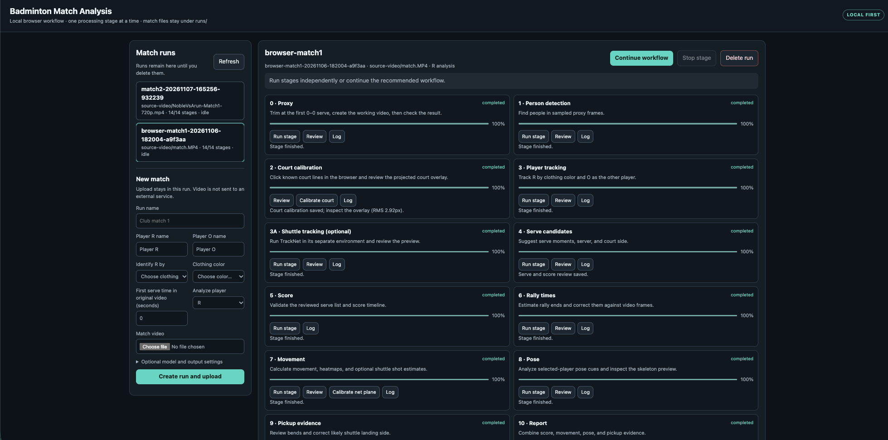
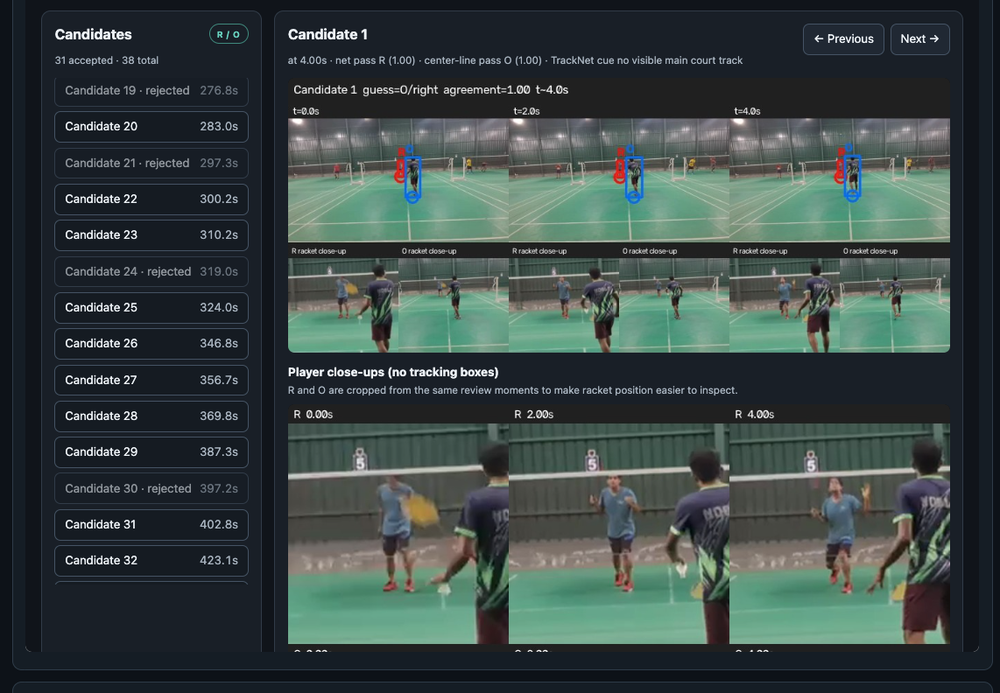
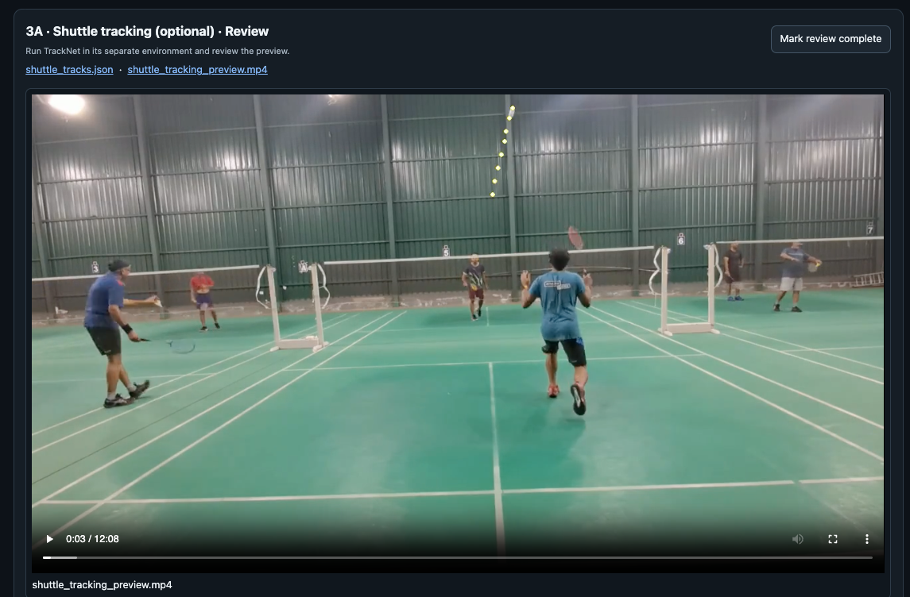

# Badminton Match Analysis

Badminton Match Analysis is a local video-analysis pipeline for singles matches. It turns a fixed phone recording into a reviewed score timeline, player movement and pose metrics, rally summaries, coaching notes, and an optional analysis video. The pipeline runs on macOS; Apple Silicon can accelerate person detection and H.264 encoding when the installed runtimes and FFmpeg support it.

Sample match analysis video of a game - [Watch on Youtube](https://youtu.be/7ueDPI99MHw)





## What it can do

- Detect and track two players, with the player you choose assigned identity **R** and the opponent **O**.
- Calibrate the court from clicked line landmarks and express player positions in court metres.
- Suggest serves, estimate rally lengths, and calculate movement, heatmaps, ready-position pose cues, and pickup evidence.
- Let you review candidate serves, correct server and court, add missed serves or score-only points, and verify the score in a local browser UI.
- Write subject-specific reports and optional coaching narratives from a local Ollama model or an exported context file.
- Render an optional full-match or short-analysis video with score, heatmaps, selected rally reviews, pose, and optional TrackNet shuttle overlays.
- Drive the pipeline from one browser dashboard: upload a match, monitor stage progress, use browser calibrations and reviews, rerun individual stages, and keep or delete each match run.

TrackNet and Ollama are optional. Results remain estimates: confirm the score and review calibration, serve candidates, rally times, shuttle evidence, and any coaching claims against the footage.

## Start here

1. Read [the installation guide](docs/how-to-install.md) and download the required model files.
2. Check the filming assumptions and stage review points in [Pipeline Architecture](docs/pipeline_architecture.md).
3. For the browser workflow, start `scripts/match_ui.py` and create a match run. For direct command-line use, follow [the command-by-command workflow](docs/command_pipeline.md). Both workflows highlight the Stage 4 serve and score review before Stage 5.

## Browser workflow

From the project root, activate `.venv` and run:

```sh
.venv/bin/python scripts/match_ui.py
```

The dashboard binds to `127.0.0.1` by default. Pass `--lan` only on a trusted local network. Runs and uploads remain under `runs/<match-id>/` until manually deleted in the UI. The dashboard permits one processing stage at a time, pauses at review gates, and also allows any individual stage to be launched when its prerequisites are ready. The existing stage scripts and Stage 4 standalone review command remain available.

For a useful analysis, film from behind one baseline with the whole singles court visible. Keep the camera still and wear clothing that makes the player to analyze easy to distinguish. Side-on footage, camera movement without recalibration, and doubles are outside the current tracking assumptions.

## Repository layout

| Path | Contents |
|---|---|
| `scripts/` | Executable pipeline stages and local review UI. |
| `templates/` | Browser UI assets and example JSON review files. |
| `docs/` | Installation, architecture, command workflow, and TrackNet reference material. |
| `runs/<match-name>/` | Match-specific source video, review files, metrics, and rendered outputs; ignored by Git. |
| `models/` | Local model weights; ignored by Git. |
| `compress_application.sh` | Packages the application and documentation without match runs. |

## Contributing

Keep changes focused on a stage or workflow. Use four spaces in Python, descriptive `snake_case` names, and explicit units for timestamps, court coordinates, and distances. Direct generated files to a match directory under `runs/`; never commit match videos, credentials, model weights, or machine-specific paths.

When changing stage behavior, update the relevant guide in `docs/`, the example command or review JSON, and any package-script file list. Use short, imperative commit subjects such as `Document calibration workflow`. Pull requests should describe the behavior change and how it was checked; include before/after images for changed charts or video overlays. The project currently has no automated test suite; use synthetic, non-match data if adding tests.

## License

The application source in this repository is licensed under the **GNU General Public License, version 3 only (GPL-3.0-only)**. See [LICENSE](LICENSE) for the license notice and the link to the full terms. Third-party libraries, model weights, and bundled TrackNet source retain their own licenses and terms.

## Attributes

The pipeline architecture and the initial prompt to get the pipelines built are based off of the work by Kiran Yelisetti - [Github](https://github.com/KiranYelisetti/badminton-ai-analysis).
