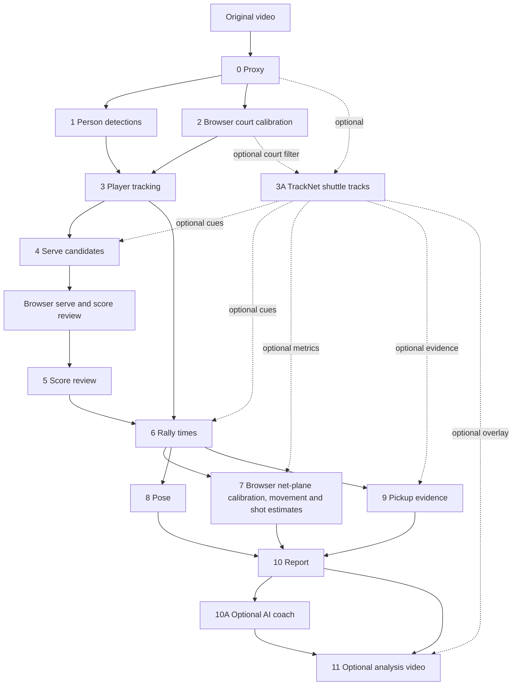

# Pipeline Architecture

The pipeline turns one fixed-camera singles video into reviewed score data, court-space player tracks, movement and pose metrics, coaching material, and an optional rendered video. Most stages can run unattended. Calibration, player identity, score, and rally-end estimates have explicit review points.

## Data flow

Every match gets its own `runs/<match-name>/` directory. The Stage 0 proxy is the shared time base: later timestamps begin at 0 at the first serve, rather than at the beginning of the original recording.

The main dashboard is `scripts/match_ui.py`. It runs one stage at a time, retains runs until manual deletion, and supports both recommended workflow continuation and independent stage launches. Browser review is available for each review gate. Stage 2 court clicks and Stage 7 net-plane clicks map from the displayed frame back to its source pixels, then call the same OpenCV calibration math used by the command-line tools.

## Stages and review gates

| Stage | Purpose and main output | Review before continuing |
|---|---|---|
| 0 — Proxy | Trim at the first serve at 0–0; create a 720p/30 fps SDR copy and timestamp sidecar. | Confirm the first serve, whole court, player visibility, and playback. |
| 1 — Detection | Detect people every few frames; write boxes and contact sheet. | Check that both players are detected. Adjacent-court people can also appear. |
| 2 — Calibration | Fit a homography from court metres to image pixels. | Click visible landmarks in the browser or desktop tool. Check that projected court lines sit on the actual court. Recalibrate after any camera move. |
| 3 — Tracking | Track both players in court metres. Clothing color identifies the selected player as R; the other player is O. | Confirm the contact sheet labels the intended player as R throughout the match. The browser review can swap R/O tracks globally if needed. R can be on either half. |
| 3A — TrackNet (optional) | Detect shuttle image coordinates, with preview and normalized JSON. | Inspect the preview and court tags. Adjacent-court switches and missing observations remain possible. |
| 4 — Serves | Propose serve candidates and estimate server and service court. | Review candidates in the browser UI. Correct false candidates, identity/side, and missed video serves. |
| Stage 4 UI | Review service candidates and edit the scoring draft in a local browser. | Save the reviewed serve list and score draft before Stage 5. |
| 5 — Score | Replay singles scoring rules and validate the full score timeline. | Confirm all video serves, manual missed serves, score-only points, and the final score. |
| 6 — Rally times | Estimate serve and rally-end timestamps; create review sheets. | Check the end of each rally against video; correct obvious estimates. |
| 7 — Movement | Distance, speed, court share, displacement/recovery, heatmaps, and optional shot estimates. | With TrackNet enabled, calibrate and confirm the browser's net-plane preview before movement analysis. Then review heatmaps, movement plausibility, and manually correct shot counts if needed. |
| 8 — Pose | Measure pose cues such as READY posture and stance for selected R or O. | Confirm the skeleton follows the intended player in the pose review image. |
| 9 — Pickups | Suggest the side where a player bent to pick up the shuttle. | Correct only clear cases; leave uncertain sides unknown. |
| 10 — Report | Combine score, movement, pose, pickup, and optional shuttle evidence into JSON and Markdown. | Review timestamps and evidence before treating a pattern as a coaching cause. |
| 10A — AI coach (optional) | Export a selected evidence prompt or generate a narrative with local Ollama. | Confirm category choices and the narrative headings before Stage 11. |
| 11 — Video (optional) | Render a full-match or short analysis video with selected review clips. | Confirm the scoring display, court map, coaching notes, voice, and optional shuttle overlay. |

## The main manual review: Stage 4 and Stage 5

Serve detection is a candidate generator, not the source of truth. In the dashboard, Stage 4 review is embedded after candidate generation. For command-line workflows, start `scripts/stage4_review_ui.py` with the same proxy, `players.json`, `serves.json`, and review directory. Both browser interfaces bind to `127.0.0.1` by default.

For each candidate, the UI shows an overview plus unannotated zoom crops for seeing the players' racket orientation. Use it to:

1. Accept or reject the candidate.
2. Set which identity served (R or O) and which service side they occupied.
3. Add a missed serve using its proxy-relative timestamp, if needed.
4. Add an untimed score-only point with timestamp zero if the match score omitted a point.
5. Check the score sequence and enter the match's final score and final point winner.
6. Press **Save review**, then run Stage 5 with the resulting `serves_reviewed.json` and `manual_score_review.json`.

Keep the UI's terminal open while reviewing. A missed video serve needs a timestamp for rally/video analysis. A score-only point changes the score progression but is excluded from video-time analysis. The dashboard also hosts the remaining manual reviews: rally-end edits, shot-count corrections, pickup-side choices, coaching category selection, and the coach narrative. See [Command Pipeline](command_pipeline.md#browser-dashboard-recommended) for launch instructions and [Command Pipeline](command_pipeline.md#stage-4-serve-candidates) for direct CLI commands.

## Coordinate and identity conventions

- Court coordinates use metres. `x=0` is the camera-view left doubles sideline; `x=6.1` is the right doubles sideline. `y=0` is the near baseline, `y=6.7` the net, and `y=13.4` the far baseline.
- Stage 2 calibration maps these court coordinates to pixels. It accounts for perspective only while the camera and court geometry remain fixed.
- Stage 3's clothing selection defines R, independent of near/far court position. O is the other tracked player. Analysis for O requires O-specific Stage 8 pose data and Stage 10 report data.
- Distances and heatmaps are meaningful only when calibration and player tracking are accurate.

## Optional analysis paths

### TrackNet

Stage 3A is independent of the main pipeline and uses a separate PyTorch environment. Its one selected shuttle point per frame can add a serve-origin cue in Stage 4, refine some Stage 6 pause estimates, support Stage 7 shot estimates, suggest a resting point in Stage 9, and draw a trail in Stage 11. These are review cues. Airborne image coordinates are not court-floor coordinates, and TrackNet does not determine an authoritative winner, landing zone, or true shuttle speed. See [TrackNet installation](how-to-install.md#optional-tracknet-shuttle-tracking) and [pilot notes](tracknet_pilot_plan.md).

### Coaching selection and AI narrative

Stage 10 writes local deterministic metrics. Stage 10A may export a prompt file for an external chat service that you choose, or send it to Ollama at localhost. Category selection and exact selected rallies are stored in a resolved JSON file. Stage 11 loads that selection by default and uses an AI note only when both its category and serve number match the selected clip; otherwise it uses the local evidence-based note. This keeps narrative and video reviews aligned.

Stage 11 can be run without Stage 10A. In that case, it uses the category selection JSON directly if supplied, or makes a stable video-specific selection. The longest playable rally is always included. See [Command Pipeline](command_pipeline.md#stage-10a-optional-ai-coach-narrative).

## Local data and privacy

The pipeline reads and writes files on the local computer. Ollama mode connects to a local service. Context-file mode makes no network request; copying its output to a hosted AI service is an explicit user action. Keep videos, weights, and generated run data out of version control.
